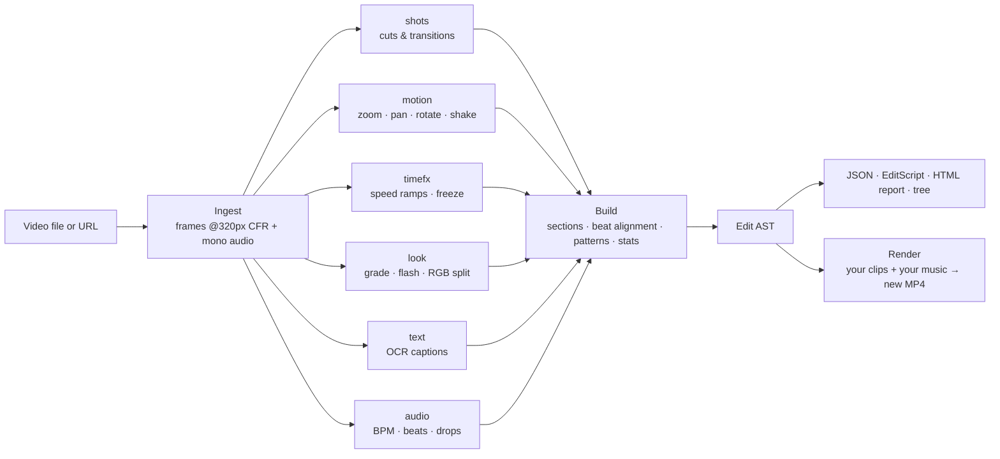

<div align="center">

# 🎬 Video Reverse Engineer

### Reverse-engineer any viral video edit into code you can read, diff and re-render.

Drop in a TikTok, Reel, Short or trailer. Get back every cut, beat, zoom, whip, speed ramp, flash and caption as a structured **Edit AST**.<br>
Then replay that edit on **your own footage and music**.

[](https://www.python.org/)
[](#-accuracy)
[](#-accuracy)
[](#-install)
[](#-contributing)
[](https://github.com/Pranav-Conova/video-reverse-engineer/stargazers)

[**Quick start**](#-quick-start) · [**What it finds**](#-what-it-extracts) · [**Real results**](#-what-10-viral-car-edits-have-in-common) · [**How it works**](#%EF%B8%8F-how-it-works) · [**Accuracy**](#-accuracy) · [**Roadmap**](#%EF%B8%8F-roadmap)

<br>


<sub>A [BMW edit by urboyliam](https://www.youtube.com/shorts/N-va3tJzyT0), reverse-engineered: 116 BPM, and after the drop at 4.3 s it cuts on every beat (18 of 19 shots).<br>See [its full EditScript](examples/demo-car-edit/youtube_N-va3tJzyT0.edit). Rendered with Remotion ([demo/](demo)).</sub>

</div>

---

## 🤔 Why?

Every viral edit follows a recipe: *hold the hook, build, then cut on every beat after the drop, punch-zoom on the hit, flash on the snare.* Editors learn these recipes by scrubbing frame by frame through other people's videos.

**Video Reverse Engineer does that scrubbing for you.** It watches the video, listens to the music, and writes the recipe down as a tree of precise, timestamped edit decisions:

- 🔍 **Learn** exactly how a viral edit was built: every cut, effect and transition, aligned to the beat.
- 📊 **Analyze at scale**: run 100 videos and find what the top performers have in common.
- 🔁 **Re-create**: use any edit as a template and render it with your clips, re-timed to a new song.
- 🧪 **Diff and compare**: two edits, two versions, or your edit against the one that went viral.

It is the difference between *"this edit feels fast"* and *"this edit cuts every beat at 116 BPM after a 4.3 s hook, with a zoom transition and RGB split on the drop."*

## ⚡ Quick start

```bash
git clone https://github.com/Pranav-Conova/video-reverse-engineer.git
cd video-reverse-engineer
pip install -e ".[ocr,fetch]"

editast analyze "https://www.youtube.com/shorts/N-va3tJzyT0"
```

That one command downloads the video and writes three files to `out/`:

| File | What it is |
|---|---|
| `*.edit.json` | The full Edit AST as JSON (with a JSON Schema). Use it in code. |
| `*.edit` | **EditScript**: a readable text language for edits that round-trips losslessly. |
| `*.report.html` | A self-contained, interactive timeline report. Open it in a browser. |

It also prints a tree and a plain-English summary to the terminal.

## 🧬 What it extracts

```
Edit
├── media      size, fps, duration, aspect
├── music      BPM, beat grid, downbeats, onsets, drops, energy, audio sections
├── timeline
│   └── section (hook / build / drop / outro …)
│       ├── shot   timing, length in beats, on-beat?, look, layout, motion
│       │   └── effects: zoom · pan · rotate · shake · speed ramp · freeze ·
│       │                flash · blur · invert · rgb_split
│       └── transition: cut · flash · fade · dissolve · whip · zoom · spin · glitch
├── overlays   burned-in text and captions (OCR, word-by-word timing)
├── patterns   inferred rules, e.g. "cuts land every beat", "zoom on the drop"
└── stats      pacing, shot lengths, cut-on-beat ratio, effect mix
```

### It infers the *rules* of the edit, not just the events

These are real `patterns` from the BMW edit above, written by the tool:

```
pattern p1 cut_every_n_beats(n=1.0, section="drop")        "In the drop, the edit cuts every beat (0.52 s at 116 BPM); 18 of 19 shots follow it."
pattern p2 pacing_accelerates_at_drop(ratio=3.788)         "Cutting speeds up when the drop hits: 0.49 -> 1.86 cuts per second (3.8x faster)."
pattern p3 effect_on_drop:rgb_split                        "A rgb split effect lands right on the drop (4.29 s)."
pattern p4 effect_on_drop:zoom                             "A zoom transition lands right on the drop (4.29 s)."
pattern p6 recurring_source(groups=["A","B","C","D"])      "The edit cuts away and comes back to the same clip 18 times."
```

### And every decision is precise and timestamped

```
shot s4 2.1667s..4.20s frames 65..126 beats 3.93 group A {
  rotate s4.rotate1 2.1667s..4.0523s 0.0deg->-3.7771deg conf 0.598
  zoom   s4.zoom1   2.1879s..2.8318s 1.0->0.8771 punch center 0.2422,0.8529 digital conf 0.906
}
transition t3 whip 2.1667s..2.20s s3->s4
```

## 🚗 What 10 viral car edits have in common

We ran the tool on the 10 most-viewed car edits from a set of YouTube Shorts searches (**1.1M to 9.4M views**) with one command:

```bash
editast batch https://www.youtube.com/shorts/kDdC6N4Q8O8 https://www.youtube.com/shorts/NRBvrNAw2uQ ... -o out/yt
```

The recipe behind the views:

| Finding | Data |
|---|---|
| 🎵 **Build, then drop** | The drop comes 35–61% of the way in. Median pace goes from **~9 cuts/min before it to 61 after**. |
| ⏳ **A long opening** | 6 of 10 hold the first shot for **4 s or more** (title card, logo, or one slow cinematic shot). |
| 🥁 **Cuts on the beat** | **73–97%** of cuts land on a beat where the beat grid is reliable. Median shot: 1–2 beats. |
| 🎥 **Constant camera motion** | Zooms (~14 per video), pans and rotations in **every** video. Speed ramps and flash frames in 7 of 10. |
| ✂️ **Few transition types** | Hard cuts dominate. Fades to black in 7, flash and whip transitions in 5 each. |

Per-video tables and frame-by-frame accuracy notes: [examples/youtube-car-edits](examples/youtube-car-edits).

## 🎞️ It works on film trailers too


<sub>24 s of the Dune trailer (© Warner Bros. Pictures & Legendary) next to its Edit AST and HTML report, in sync.</sub>

## 🛠️ Usage

```bash
editast analyze clip.mp4            # -> out/clip/clip.edit.json, clip.edit, clip.report.html
editast analyze "https://..."       # any URL yt-dlp supports: YouTube, TikTok, Instagram ...
editast show out/clip/clip.edit.json --format tree   # tree | dsl | compact | json | summary
editast batch videos/ -o out/batch  # what do many viral edits have in common?
editast compare a.edit.json b.edit.json             # structural similarity of two edits
editast render out/clip/clip.edit.json --clips my_footage/ --music song.mp3 --retime -o remix.mp4
editast bench --n 5                 # score the analyzers on synthetic ground truth
editast schema -o edit.schema.json  # JSON Schema of the Edit AST
```

### 🔁 Turn any edit into a template

```bash
editast analyze viral.mp4
editast render out/viral/viral.edit.json --clips my_footage/ --music my_song.mp3 --retime -o mine.mp4
```

`--retime` re-fits every cut and effect to your song's tempo, so the structure of the viral edit lands on *your* beats. The loop is tested end to end: analyze → re-time → render → analyze again recovers the new song's tempo and every cut.

### 🐍 Use it from Python

```python
from editast.pipeline import analyze

result = analyze("viral.mp4")
edit = result.edit

if edit.music:
    print(f"{edit.music.bpm:.1f} BPM")
for pattern in edit.patterns:
    print(pattern.description)   # e.g. "In the drop, the edit cuts every beat ..."
```

## ⚙️ How it works



1. **Ingest**: decode once at analysis resolution (long side 320 px) at a constant frame rate, plus mono audio. ffmpeg comes bundled via `imageio-ffmpeg`.
2. **Analyzers**, each producing AST fragments:
   - `shots`: cuts and transitions (adaptive thresholds, flash, fade and dissolve detection)
   - `motion`: per-frame similarity transforms (feature tracking + RANSAC) giving zoom, pan, rotate and shake, with fitted easing curves
   - `timefx`: speed ramps, slow motion and freeze frames
   - `look`: colour grade, B&W, in-shot flashes, blur, invert, RGB split, letterbox
   - `text`: caption detection and tracking, with OCR via RapidOCR (offline)
   - `audio`: tempo, dynamic-programming beat tracking, downbeats, drops and sections (numpy/scipy only)
3. **Build**: sections, beat alignment, source-clip grouping, pattern inference and stats.
4. **Render** (the inverse direction): apply an AST as a template to your own clips, optionally re-timed to a new song.
5. **Bench**: generate synthetic edits with a *known* AST, render them, analyze them, and score recovered vs. true AST.

No GPU, no cloud API, no API keys. A 52 s trailer is fully analyzed in about **25 s on a laptop CPU**.

See [PLAN.md](PLAN.md) for the architecture and module contracts, and `editast/ast/nodes.py` for the AST definition.

## 📏 Accuracy

Video Reverse Engineer ships with its own benchmark: it generates edits with a known ground-truth AST, renders them, reverse-engineers them, and scores the result.

| Benchmark | Overall | Cuts F1 | Transitions | Effects F1 | Beats F | Text F1 | B&W |
|---|---|---|---|---|---|---|---|
| Synthetic, seeds 100–107 (held out from tuning) | **0.994** | 0.995 | 1.000 | 0.982 | 0.988 | 1.000 | 1.000 |
| Synthetic, seeds 0–3 | 0.999 | 1.000 | 1.000 | 1.000 | 0.993 | 1.000 | 1.000 |

**On real video:** on the [Sintel trailer](https://durian.blender.org/) (CC-BY Blender Foundation, 52 s), shot boundaries score **precision 0.95 and recall 1.00** against hand labels (`tests/data/sintel_trailer_boundaries.json`), including fades through black and white, title cards and long dissolves. Its single real slow-motion shot (0.48x) is found with no false speed effects, and its 11-line end credits are read with correct word spacing.

<details>
<summary><b>Known limits</b> (we'd rather tell you than have you find out)</summary>

- About a quarter of speed ramps are missed on the synthetic benchmark; speed is tuned for precision over recall.
- Long dissolves are found, but their start is placed late.
- A dissolve into a title card is reported as a cut.
- On the 10 YouTube car edits, spot checks found three issues: static-noise glitch transitions are split into many tiny shots, the beat tracker can lock onto off-beats, and text in the footage (such as licence plates) can be reported as an overlay.

</details>

## 📦 Install

Requires Python 3.10+.

```bash
git clone https://github.com/Pranav-Conova/video-reverse-engineer.git
cd video-reverse-engineer
python -m venv .venv
# Windows: .venv\Scripts\activate    macOS/Linux: source .venv/bin/activate
pip install -e ".[ocr,fetch,dev]"
```

| Extra | Adds |
|---|---|
| `ocr` | Caption and text reading (RapidOCR, offline) |
| `fetch` | Download from URLs (yt-dlp) |
| `dev` | pytest |

Downloading from YouTube also needs [Deno](https://deno.com/) or [Node.js](https://nodejs.org/) on the PATH: yt-dlp uses it to solve YouTube's signature challenges.

## 🎯 Who is this for?

- **Video editors and creators** who want to learn the exact structure of edits that perform.
- **Social media and growth teams** studying what top-performing short-form content does differently.
- **Researchers** in video understanding, computational editing and music–video synchronization.
- **Developers** building auto-editing, template or "make it look like this" features.

## 🗺️ Roadmap

- [ ] Better speed-ramp recall
- [ ] Glitch transitions detected as one transition, not many tiny shots
- [ ] Off-beat lock detection in the beat tracker
- [ ] Separate scene text (licence plates, signs) from editor overlays
- [ ] Export to editing apps (Premiere / DaVinci Resolve / CapCut timelines)
- [ ] Hosted web demo: paste a link, get the report

Have an idea? [Open an issue](https://github.com/Pranav-Conova/video-reverse-engineer/issues).

## 🤝 Contributing

Contributions are welcome, especially new analyzers, better accuracy on real-world edits, and new example datasets.

```bash
python -m pytest                                  # 385 tests
EDITAST_REAL_TESTS=1 python -m pytest -k sintel   # also score the real Sintel trailer (downloads ~4 MB)
editast bench --n 5                               # check your change against the benchmark
```

If you change an analyzer, please include the `editast bench` scores before and after in your pull request.

## ⚖️ A note on content

This tool analyzes the *structure* of an edit. The example folders contain only Edit ASTs, never the original videos, because those belong to their creators. Please respect creators' rights and platform terms when downloading and analyzing videos.

## ⭐ Star history

If this project helped you understand an edit, a star helps other people find it.

[](https://star-history.com/#Pranav-Conova/video-reverse-engineer&Date)
