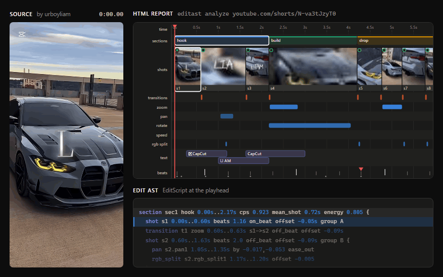
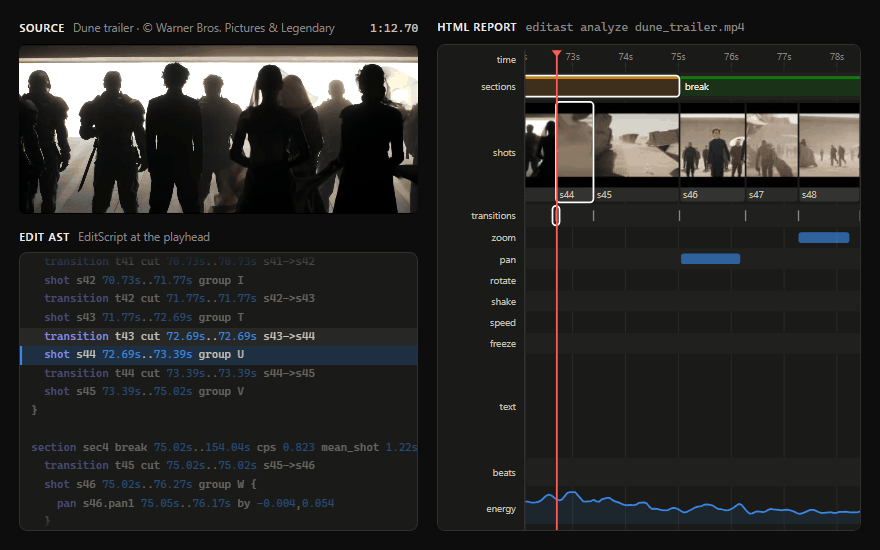

<sub>A [BMW M4 edit by Revix Edits](https://www.youtube.com/shorts/YFNSDdrElfc) (1.1M views): 136 BPM, 90% of cuts on the beat, and cutting 5.7× faster after the drop ([its EditScript](examples/youtube-car-edits/youtube_YFNSDdrElfc.edit)). Rendered with Remotion; see [demo/](demo).</sub>

# Video-to-AST

Reverse-engineer viral short-form video edits (TikTok / Reels / Shorts, beat-synced
car "velocity" edits, caption-driven clips) into an **Abstract Syntax Tree**: a
structured, readable description of *how* the video was edited. You can read it,
diff it, aggregate it across many videos, and compile it back into a new video
with your own footage and music.

## Status

Every module is implemented and tested (385 tests, one of them opt-in). Measured accuracy:

| Benchmark | Overall | Cuts F1 | Transitions | Effects F1 | Beats F | Text F1 | B&W |
|---|---|---|---|---|---|---|---|
| Synthetic, seeds 100–107 (held out from tuning) | 0.994 | 0.995 | 1.000 | 0.982 | 0.988 | 1.000 | 1.000 |
| Synthetic, seeds 0–3 | 0.999 | 1.000 | 1.000 | 1.000 | 0.993 | 1.000 | 1.000 |

On a real video, the [Sintel trailer](https://durian.blender.org/) (CC-BY Blender
Foundation, 52 s), shot boundaries score precision 0.95 and recall 1.00 against
hand labels in `tests/data/sintel_trailer_boundaries.json`. That covers fades
through black and white, title cards and long dissolves. Its single real
slow-motion shot (frame repeats, 0.48x) is found with no false speed effects. Its
title cards and 11-line end credits are read with correct word spacing. The full
analysis takes about 25 s on a laptop CPU.

Analyze → re-time → render → analyze recovers the new song's tempo and every cut
(see `test_template_loop_analyze_retime_render_reanalyze`).

Known limits:
- About a quarter of speed ramps are missed on the synthetic benchmark; speed is
  tuned for precision over recall.
- Long dissolves are found, but their start is placed late.
- A dissolve into a title card is reported as a cut.
- Thresholds were tuned on one real trailer plus synthetic edits. On 10 viral car
  edits from YouTube ([examples/youtube-car-edits](examples/youtube-car-edits)),
  spot checks found three issues. Static-noise glitch transitions are split into
  many tiny shots. The beat tracker can lock onto the off-beats. Text in the
  footage, such as licence plates, can be reported as an overlay.

## Example: 10 viral car edits

[examples/youtube-car-edits](examples/youtube-car-edits) holds the ASTs of the 10
most-viewed car edits from a set of YouTube Shorts searches (1.1M–9.4M views),
produced with one command:

```bash
editast batch https://www.youtube.com/shorts/kDdC6N4Q8O8 https://www.youtube.com/shorts/NRBvrNAw2uQ ... -o out/yt
```

What they share:
- **Build, then drop:** the drop comes 35–61% of the way in, and the median pace
  goes from about 9 cuts/min before it to 61 after it.
- **A long opening:** 6 of 10 hold the first shot for 4 s or more.
- **Cuts on the beat:** 73–97% of cuts land on a beat where the beat grid is reliable.
- **Constant camera motion:** zooms (about 14 per video), pans and rotations in
  every video, and speed ramps and flash frames in 7 of 10.

The folder's README has the per-video table and frame-checked accuracy notes.

## Example: a film trailer



<sub>24 s of the Dune trailer (© Warner Bros. Pictures & Legendary) next to its Edit AST and HTML report, in sync. Rendered with Remotion; see [demo/](demo).</sub>

## What it extracts

```
Edit
├── media      size, fps, duration, aspect
├── music      BPM, beat grid, downbeats, onsets, drops, energy, audio sections
├── timeline
│   └── section (hook / build / drop / outro …)
│       ├── shot   timing, length in beats, on-beat?, look, layout, motion
│       │   └── effects: zoom · pan · rotate · shake · speed ramp · freeze ·
│       │                flash · blur · invert · rgb_split
│       └── transition: cut · flash · fade · dissolve · whip · zoom · spin · glitch
├── overlays   burned-in text / captions (OCR, word-by-word timing)
├── patterns   inferred rules, e.g. "cuts land every 2 beats", "zoom on the drop"
└── stats      pacing, shot lengths, cut-on-beat ratio, effect mix
```

The AST is available as JSON (with a JSON Schema), as **EditScript** (a readable
text language that round-trips losslessly), as a self-contained HTML timeline
report, and as a terminal tree.

## How it works

1. **Ingest**: decode once at analysis resolution (long side 320 px) at a constant
   frame rate, plus mono audio. ffmpeg comes bundled via `imageio-ffmpeg`.
2. **Analyzers**, each producing AST fragments:
   - `shots`: cuts and transitions (adaptive thresholds, flash, fade and dissolve detection)
   - `motion`: per-frame similarity transforms (feature tracking + RANSAC), giving zoom, pan, rotate and shake with fitted easing curves
   - `timefx`: speed ramps, slow motion and freeze frames
   - `look`: colour grade, B&W, in-shot flashes, blur, invert, RGB split, letterbox
   - `text`: caption detection and tracking, with OCR via RapidOCR (offline)
   - `audio`: tempo, dynamic-programming beat tracking, downbeats, drops and sections (numpy/scipy only)
3. **Build**: sections, beat alignment, source-clip grouping, pattern inference and stats.
4. **Render** (the inverse direction): apply an AST as a template to your own clips,
   optionally re-timed to a new song's tempo.
5. **Bench**: generate synthetic edits with a *known* AST, render them, analyze
   them, and score recovered vs. true AST.

See [PLAN.md](PLAN.md) for the architecture and module contracts, and
`editast/ast/nodes.py` for the AST definition and its conventions.

## Install

Requires Python 3.10+.

```bash
python -m venv .venv
# Windows: .venv\Scripts\activate    macOS/Linux: source .venv/bin/activate
pip install -e ".[ocr,fetch,dev]"
```

Downloading from YouTube also needs [Deno](https://deno.com/) or [Node.js](https://nodejs.org/)
on the PATH: yt-dlp uses it to solve YouTube's signature challenges.

## Usage

```bash
editast analyze clip.mp4            # -> out/clip/clip.edit.json, clip.edit, clip.report.html
editast analyze "https://..."       # downloads with yt-dlp first
editast show out/clip/clip.edit.json --format tree   # tree | dsl | compact | json | summary
editast render out/clip/clip.edit.json --clips my_footage/ --music song.mp3 --retime -o remix.mp4
editast batch videos/ -o out/batch  # common patterns across many viral edits
editast compare a.edit.json b.edit.json
editast bench --n 5                 # score the analyzers on synthetic ground truth
editast schema -o edit.schema.json
```

## Tests

```bash
python -m pytest
EDITAST_REAL_TESTS=1 python -m pytest -k sintel   # also score the real trailer (downloads ~4 MB)
```
